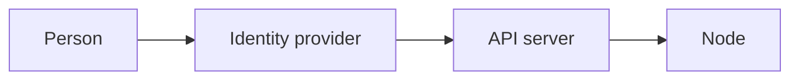

The identity provider authenticates the person. The cluster still has to decide what that session is allowed to touch.

## The handoff

A token arrives at the API server. The authenticator checks the signature and the issuer, then attaches a username and a set of groups to the request. The username is a string the cluster can store. It is not, by itself, a permission.

The [Kubernetes authentication reference](https://kubernetes.io/docs/reference/access-authn-authz/authentication/) describes the handoff. This note only needs the shape of it.

### What the API server keeps

The request carries the username from that moment on. The token is evidence. It is not the identity the rest of the system reads.

## What remains on the node

The diagram is the path from the person to the machine that still has to accept the request.



A manifest line can be longer than the measure. The block scrolls. The sentence does not.

```yaml
apiVersion: v1
kind: Config
clusters:
  - name: example
    cluster:
      server: https://cluster.example
      certificate-authority-data: bG9uZ2NlcnRkYXRhdGhhdGlzb25seWFuZXhhbXBsZWFuZG5vdGFyZWFsc2VjcmV0bG9uZ2NlcnRkYXRh
```

| Step | Stays | Leaves |
| --- | --- | --- |
| Sign-in | Session | Password |
| Request | Username | Raw token |

Nothing in the diagram removes the need for a credential on the node. It only shows which ones the session does not replace.
